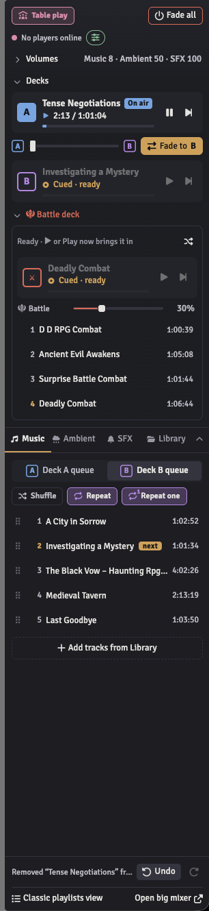

#  Music Deck

Two music decks with a crossfader, an ambient channel and sound effects for Foundry VTT v14. You play them from a redesigned Playlists tab or an Elgato Stream Deck+, and everyone in the game hears the same mix, remote players included.

To install, paste this manifest URL into Foundry's **Add-on Modules › Install Module** ([details below](#install)):

```text
https://github.com/EdenMichal/music-deck/releases/latest/download/module.json
```

## Screenshots

| Music: Deck A, Deck B and the Battle deck | Ambient layers and sound scenes | Library |
| :---: | :---: | :---: |
|  |  |  |

## What you need

- **Foundry VTT v14.**
- **The Foundry desktop app or Chrome** for the GM. Safari can't link to the Stream Deck (see [Browsers](#browsers)).
- **A Stream Deck+**, if you want one, with the Stream Deck app 7.1 or later on the same computer as the GM's Foundry window (macOS 12+ or Windows 10+). The Playlists tab and the keyboard shortcuts do everything without it.
- **Music** in Foundry's own playlists, in whatever folders you like, or as files in `Data/music/`. MP3 or OGG at 128 to 192 kbps is plenty. The Library shows both.

## Install

### 1. The Foundry module

1. In Foundry's setup screen, open **Add-on Modules**, click **Install Module**, and paste this manifest URL into the box at the bottom:
   ```text
   https://github.com/EdenMichal/music-deck/releases/latest/download/module.json
   ```
2. In your world, tick **Music Deck** in **Game Settings › Manage Modules**.
3. Open the world as GM. The first time, Music Deck creates its own playlists, all named `Music Deck – …`, for the decks, the ambience and the SFX pads.

Foundry's **Check for Updates** finds new versions through the same URL.

### 2. The Stream Deck plugin

1. Download `com.edenmichal.musicdeck.streamDeckPlugin` from the [latest release](https://github.com/EdenMichal/music-deck/releases/latest) and double-click it. The Stream Deck app installs it.
2. In the Stream Deck app, open the **Music Deck** category and drag:
   - **Music Dial** to a dial (dial 1 works well),
   - **Ambient Dial** to another dial,
   - **SFX Dial** to dial 4,
   - **Scene Mix Dial**, if you want it, to a dial on another page, to mix stacked sound scenes,
   - **SFX Pad**, **Auto-fade**, **Panic**, **Next Track**, **Set Track**, **Ambient Layer**, **Sound Scene** and **Scene Combo** to keys.

   Each key's settings pick what it plays: the SFX Pad's sound, Set Track's track, Ambient Layer's layer, Sound Scene's scene and Scene Combo's scenes. Make the scenes in Foundry's Ambient tab first. Use more pages for more keys, such as a "Sounds" page of layer and scene keys.

### 3. Pair them (once per browser)

1. Open your world as GM. The Music Deck dials and keys show a 4-digit code, and Foundry asks for it.
2. Type the code and press **Pair**.

From then on, the GM's Foundry window links to the deck by itself whenever both are open, in either order. The deck chip in the Playlists tab's status line is green while they're linked. If you close the code dialog, the chip turns into a **Pair deck** button.

## Playing

### The GM

- **Playlists tab.** Both decks, the crossfader, the music and ambient levels, and **Fade all** (panic) sit at the top. Below them are the Music queues, Ambient layers, SFX pads and the Library.
- **Table play or Online play.** One button at the top of the tab shows the mode, and a click switches it for everyone at once. Use **Table play** when everyone is in the room. Only your computer plays sound and every player's Foundry stays quiet, so nothing echoes. Use **Online play** when everyone is remote, and each player hears Foundry on their own device.
- **Status line.** It shows how many players are online. In Online play, an amber **can't hear** chip names anyone whose browser hasn't had its first click yet.
- **Big mixer.** **Open big mixer ↗** in the footer opens the same view in its own window.

### Library

- **Playlists** shows Foundry's Playlists sidebar in its folders, without Music Deck's own playlists. **Files** shows the folders in `Data/music/`. Music Deck remembers which one you picked.
- Click a folder or playlist to open it, and use the breadcrumb at the top to go back up. Search covers the folder you're in and everything below it.
- Each track has 🎧 preview (only you hear it), then ＋A ＋B ＋Amb ＋SFX. Hover a folder or playlist for **＋A all** and **＋B all**, which add every track inside to that deck's queue.
- **Battle music.** Right-click a folder or playlist and choose **Use for battle music**. It gets a ⚔.
- **Random SFX pad.** Hover a folder or playlist and press **＋SFX 🎲**. You get one pad named after the folder. Each press plays a different sound from it, never the same one twice in a row, and sounds you add to the folder later are included.

### SFX Dial and ducking

- **SFX Dial** (dial 4). Turn it for the SFX pads' level, press it to mute, and tap the strip to stop any SFX that's playing. The Playlists tab has the same SFX level row.
- **Ducking.** While an SFX pad plays, the music dips to half and comes back about a second later. Ambience doesn't dip. Settings can turn this off or change how far the music dips.

### Set Track key

Put one track on a key, such as "Tavern Theme" or "Ambush". In the key's settings, pick the track from Foundry's Library. Your own playlists come first, then the folders in `Data/music/`, grouped by playlist or folder. The list arrives when Foundry links and follows the Library as it changes.

- **Something is playing.** The deck that's playing fades from its track to this one, using the deck's own **Fade between tracks**. The track joins that deck's queue right after the one that was playing, so the queue carries on from there.
- **The track is already on that deck.** The deck fades to that copy instead of adding another. If it's already playing, nothing happens.
- **Nothing is playing.** The track starts on the deck you're hearing.
- **During a battle.** The key works the **Battle deck** the same way and fades the battle music to this track. A and B stay paused where they were, so **Back to A/B** or the end of combat picks them up as usual.
- The crossfader, the other deck and the levels stay as they are. The key shows the track's name and lights up while the track plays on A, B or the Battle deck.

### Combat

The **Battle deck** sits under decks A and B and plays your battle music in a random order. It shows what's playing and its queue (**Play now**, remove), with ▶/⏸, next track, cues and its own **Battle** level. The shuffle button reloads it from the battle music you chose in the Library.

**Begin Combat** fades to it, and so do its ▶ and **Play now** at any time. Decks A and B fade out and pause where they were, and the Battle deck never touches their queues. When the combat ends or is deleted, or you press **Back to A/B**, the Battle deck fades out and stops, and A and B carry on from where they paused. It keeps its queue, so the next battle starts on the track after the last one. It comes in at 30% each time (**Battle deck starting level** in Settings), and its section folds away like Volumes and Decks. **Combat auto-cue** in Settings turns off the combat part.

While the Battle deck is in, the Stream Deck's **Music Dial** works it. Turn it for the level, and tap or hold the strip for the next battle track. **Next Track**, **Set Track** and the cue keys without a deck of their own follow it too.

**Music plays when you select a token?** That's the map's own Ambient Sound, one of the speaker icons on the Ambient Sounds layer. Foundry plays those from the selected token's position at its Environment volume, so Music Deck's levels don't reach them. Delete the speaker, or turn down Environment in Foundry's volume settings.

### Map scenes

In a scene's configuration, under **Miscellaneous › Audio › Music Deck sound scene**, pick a sound scene. When you activate that scene for the players, the sound scene fades in as if you'd pressed its Sound Scene key. "None" leaves the sound alone.

### Players

- **Online play shows "Click to turn on sound."** Browsers won't play sound until you click in the page once. Until a player does, a banner asks for that click, and the GM's status line names them.
- **In Table play** their Foundry's music, ambience and interface sounds stay off, whatever their volume sliders say, and their Playlists tab says the music comes from the GM's speakers. They don't need to do anything.

### Ambient layers and sound scenes

- **Sound scenes.** A sound scene is a named group of ambient layers, such as "Night Camp" with a quiet campfire and crickets. Each scene owns its layers. The Ambient tab lists every scene with its layers underneath, and a layer's slider is its level in that scene. If two scenes both want rain, each has its own rain layer, so changing one never touches the other.
- **Playing a scene.** The ▶ on a scene fades its layers in and every other scene's layers out over 2 seconds. Press it again (■) to fade the scene out. Click a scene's name to show or hide its layers.
- **More than one scene at once.** Hold a Sound Scene key for half a second, or Shift-click a scene's ▶, to add that scene on top of whatever is playing, such as Forest Day with Thunderstorm Camp. Every scene that's playing lights up. Hold or Shift-click again to fade just that scene out. A plain press still switches to that scene alone.
- **Several scenes on one key.** A **Scene Combo** key plays two or more scenes with one press. Tick the scenes in its settings. A **Title** is optional, and without one the key shows the scenes' names. A press fades in every scene it holds and fades out everything else, General layers included. Press it again while just those scenes play to fade them out. The key lights up while all of its scenes play. It skips a scene you've deleted since, and if none are left, the key shows a warning.
- **Mixing scenes against each other.** Each scene has a **Level** slider under its name, which shows even while the scene is folded. It sets that scene's layers against the other scenes, on top of the Ambient level, and Music Deck remembers it. On the deck, press the **Ambient Dial** to step from the Ambient level through each scene that's playing and back, then turn it for the level the strip shows. A separate **Scene Mix Dial** does only the scene part, if you have a spare dial.
- **A scene remembers its mix.** Turn one of its layers off, with its toggle or its Ambient Layer key, and the next time you play the scene that layer stays off until you turn it on again. A layer that's off in its scene shows crossed out while the scene isn't playing. A grassland camp might have wind, campfire and forest, with forest off until the party wanders back to the trees.
- **General layers.** These belong to no scene and play alongside any scene. Switching scenes never fades them, so a thunderstorm can stay on from Forest Day into Forest (Night). Turn them on and off with their own toggles or Ambient Layer keys. Scenes don't remember General layers. Click **General** to show or hide its layers, as with a scene.
- **General follows a folder.** Every sound in your **Ambience** playlist is a General layer and stays in step with it. Add a file there and it appears, remove it and it goes, and 🔗 marks these layers. To follow a different folder or playlist, right-click it in the Library and choose **Use for general ambience** (it gets a ☁). **Stop using for general ambience** turns that off. Layers you add to General yourself stay until you delete them.
- **Moving layers.** Right-click any layer and choose **Move to…** for another scene or General. A General layer that follows the folder gets copied into the scene instead, so General keeps it.
- **Ambient Layer key.** One key per layer, such as a campfire or a General thunderstorm. Press it to fade the layer in and again to fade it out, and the key lights up while the layer plays. Its picker lists each layer as "Scene › Layer" or "General › Layer". The Ambient Dial sets the overall level. Turn it for the level, hold it to mute, and tap its strip to pause or bring back the layers.

**Adding layers to a scene.** Press **＋ Add a layer from the Library** under the scene, then **＋Amb** on the sounds you want, and they go into that scene. Otherwise ＋Amb adds to the scene that's playing, or to General if none is, and its tooltip says which. The **×** on a layer deletes it, and Undo puts it back.

**Making or editing a scene in Foundry.** **＋ New scene…** at the bottom of the Ambient tab opens the editor, and so does the ✎ on a scene or **Edit…** when you right-click its name. Nothing has to be playing.

- Each layer has its level and a **×**. A layer you remove here goes when you press **Save**.
- **＋ Add a sound** searches the other ambient layers and the Library as you type. Click a result or press Enter. A General layer moves into the scene (one that follows the folder gets copied), another scene's layer gets copied, and a Library file becomes a new layer when you press **Save**.
- Right-clicking a scene's name also offers **Add the layers playing now**, and **Delete**, which deletes the scene and its layers.

The first time the GM opens a world after this change, Music Deck converts its older scenes. A layer that two scenes shared becomes one layer per scene, at the level each scene had saved.

**Seamless loops.** Ambient layers crossfade their last 3 seconds into their start, so a loop doesn't click or cut. Your files stay as they are. Files over 10 minutes loop the way Foundry loops them.

**A scene on a key, with your lighting.** In the Stream Deck app, drag a **Multi Action** from the Stream Deck category onto a key, then drag these into it, in this order:

1. Philips Hue › **Set Scene**, with your room and Hue scene, such as "Out Night".
2. Music Deck › **Sound Scene**, with the sound scene, such as "Night Camp". Use a **Scene Combo** instead to play several scenes, such as "Night Camp" with "Thunderstorm".

You can add more steps, such as an **SFX Pad** or **Auto-fade**. One press then sets the lights and fades in the sound, and if Foundry isn't open, the lights still change. You can't hold a Multi Action, so a Sound Scene inside one acts as a press. Use a plain Sound Scene key to stack scenes. A Scene Combo works the same inside a Multi Action as on its own key. For several scenes, use one Scene Combo rather than two Sound Scenes, because the second Sound Scene would switch away from the first.

### Levels

- **Every sound plays at the same loudness.** Recordings differ a lot. In one world's Ambience folder, Medieval City was about 12 times louder than Forest (Night). So Music Deck measures each file once and evens them out. A file plays at its own volume for a moment until it's measured.
- **A % is a % of that.** 70% on any Music Deck slider or dial is 0.7 of the sound's matched level. Levels multiply, so an ambient layer at 50% in a scene at 50% with Ambient at 80% plays at 0.5 × 0.5 × 0.8 = 20%.
- **Deck tracks and SFX pads play at full.** The Music and SFX levels set them.
- **Foundry's Music volume**, in its Playlists sidebar, sets all of Music Deck on that computer. Foundry's Ambient and Interface volumes don't touch it.

### Settings

| Setting | Who | What it does |
|---|---|---|
| Where you're playing | World | Table play or Online play (the default). The same switch as the top of the Playlists tab. |
| Crossfade time (seconds) | World | How long Auto-fade takes, from the Fade button, a tap on the Music Dial's strip or the Auto-fade key. Default 4 seconds. |
| Fade between tracks (seconds) | World | When a deck moves to another track (Play now, Next, or a track ending), the old one fades out while the new one fades in, so there's no gap. Default 3 seconds. 0 switches straight away. |
| Match loudness | World | The GM's browser measures every track, layer and SFX once in the background, and Music Deck plays each at the same loudness. Two sounds at the same % then sound equally loud. On by default. |
| Duck music under SFX | World | The music dips while an SFX pad plays. On by default. |
| Duck music to (%) | World | How loud the music stays while an SFX plays. Default 50%. |
| Combat auto-cue | World | Begin Combat fades to your battle music, and ending combat fades back. On by default. It does nothing until you choose battle music in the Library. |
| Use classic Playlists tab | World | Turns the Music Deck tab off and brings back Foundry's own. The decks, the Stream Deck and the shortcuts still work. |
| Connect to Stream Deck | Each browser | Links this browser to the Stream Deck plugin. Only the GM who runs the mixer connects. |

The keyboard shortcuts (auto-fade, fader, music volume, mute, panic, next) have no default keys. Set them in **Configure Controls › Music Deck**.

## Audio routing (Pocket Bard, Wave Link and Discord)

This part is optional, for a GM who also runs [Pocket Bard](https://pocketbard.app). Pocket Bard plays its own ambience and has no link to Foundry. Elgato's Wave Link mixes it with everything else (version 3.4 or later mixes per app on macOS), and Wave Link's own Stream Deck plugin puts its level on a dial.

1. Set the computer's sound output to **Wave Link › Personal Mix**, and the Personal Mix output to your speakers.
2. In Wave Link, make a software channel called **Ambience** and add Pocket Bard to it.
3. On the Stream Deck+, drag Wave Link's **Channel Level** action onto a dial, pick "Ambience" and choose **all mixes**, so the room and the remote players both follow the dial.
4. For remote players, set Discord's input to **Wave Link Stream Mix**, with only your mic and Pocket Bard in that mix.

```
                 ┌─ Personal Mix ──▶ Mac speakers (the table)
 Pocket Bard ──▶ Wave Link
 Foundry/Chrome ─┤
 Your mic ───────┴─ Stream Mix ────▶ Discord input (remote players)
                    (mic + Pocket Bard only)
```

- **Remote players hear Foundry through Foundry itself**, so leave Foundry and the browser out of the Stream Mix. Otherwise they hear the music twice, slightly out of step.
- They hear Pocket Bard and your voice through Discord.
- If Wave Link isn't running, the Mac has no sound.

## Browsers

- **Use the Foundry desktop app or Chrome for the GM.** The deck link is a connection from the GM's Foundry window to the plugin on `127.0.0.1:31420`.
- **Chrome may ask to "look for and connect to devices on your local network"** when Foundry runs at an address other than `localhost`, such as a hosting service or another computer's IP. Allow it, or the deck stays on "Foundry not connected".
- **Safari** blocks a secure (https) page from connecting to the deck, so the Stream Deck won't link from it. Players can use any browser.

## Troubleshooting

| What you see | What to do |
|---|---|
| The dials say **Foundry not connected** | Open the world as GM in Chrome or the Foundry app. If another GM is logged in, the status line says who's running the mixer, and only that GM's window links. |
| A Sound Scene or Ambient Layer key flashes a warning | Foundry isn't linked, or someone deleted the key's scene or layer. Pick it again in the key's settings. |
| A Set Track key's list says **Connect Foundry first**, or misses new files | Open the world as GM so the link sends the list. New files in `Data/music/` show up after **Rescan** in the Library. |
| The dials show a **code** | A browser is waiting to pair. Type the code in its Foundry dialog, or click **Pair deck** in the status line. |
| Foundry says the module and plugin are **different versions** | Update both from the same [release](https://github.com/EdenMichal/music-deck/releases/latest). Update the module in Foundry and double-click the plugin's file, then reload Foundry. |
| A remote player hears nothing | Check that the mode button says **Online play**. If the status line says they can't hear, they need to click once in Foundry. |
| Players' laptops echo the music at the table | Click the mode button so it says **Table play**. |
| Remote players hear the music twice | Take Foundry and the browser out of Wave Link's Stream Mix. |
| A track stutters for remote players | Very large WAV files load slowly over the internet. Convert them to MP3 or OGG. |

## Development

```bash
npm install
```

```bash
npm run build
```

```bash
npm test
```

```bash
npm run typecheck
```

- `npm run watch` rebuilds the module on save. Reload Foundry to pick up the change.
- `npm run install-local -w deck-plugin` copies the built plugin into the Stream Deck app and restarts it. Run it after each plugin rebuild. It works on macOS only.
- `npm run pack -w deck-plugin` builds the installer in `deck-plugin/dist/`.
- To try the module from a checkout, link `module/` into Foundry's data folder as `Data/modules/music-deck` and run `npm run build`.
- `node tools/render-icons.mjs` renders the plugin icons from `module/assets/icon.svg`. It needs Playwright.

### Releasing

Bump `version` and the `download` URL in `module/module.json`. When `DECK_PROTOCOL` in `shared/protocol.ts` changes, also bump the plugin's `Version` in its `manifest.json`, because the Stream Deck app won't reinstall a plugin with the same version. Then push a tag such as `v1.0.1`. The Release workflow builds the module zip and the `.streamDeckPlugin` and attaches both, with `module.json`, to a GitHub release.

## More modules

- **[Encounter Deck](https://github.com/EdenMichal/encounter-deck).** Encounter prep by campaign for D&D 5e. Fights run as real Foundry combat with the monster tokens kept off the map, and a carousel shows the whole table whose turn it is.
- **[Mobile Deck](https://github.com/EdenMichal/mobile-deck).** A phone and tablet interface for Foundry (D&D5e and PF2e), with a Character Builder and party inventory.

## License

[MIT](LICENSE).

The Stream Deck property inspector bundles [sdpi-components](https://sdpi-components.dev) (MIT), © Corsair Memory Inc. and contributors.
