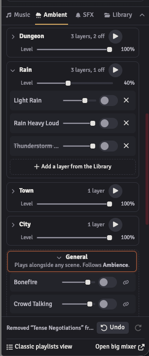
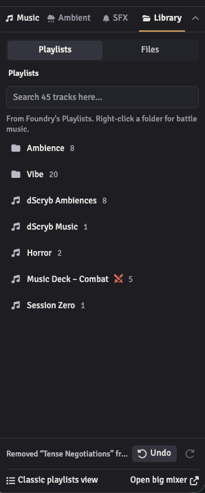

#  Music Deck

Two music decks with a crossfader, an ambient channel and sound effects for Foundry VTT v14, played from a redesigned Playlists tab or an Elgato Stream Deck+. Everyone in the game hears the same mix, including remote players.

## Screenshots

| Music: Deck A, Deck B and the Battle deck | Ambient layers and sound scenes | Library |
| :---: | :---: | :---: |
|  |  |  |

## What you need

- **Foundry VTT v14.**
- **The Foundry desktop app or Chrome** for the GM. Safari can't link to the Stream Deck (see [Browsers](#browsers)).
- **A Stream Deck+** and the Stream Deck app 7.1 or later on the same computer as the GM's Foundry window (macOS 12+ or Windows 10+). The Stream Deck is optional: the Playlists tab and the keyboard shortcuts do everything without it.
- **Music** in Foundry's own playlists (organised in folders as you like), or as files in `Data/music/` (MP3 or OGG, 128–192 kbps is plenty). The Library shows both.

## Install

### 1. The Foundry module

1. In Foundry's setup screen: **Add-on Modules › Install Module**, and paste this manifest URL:
   ```
   https://github.com/EdenMichal/music-deck/releases/latest/download/module.json
   ```
   Or extract `music-deck-v….zip` from the [latest release](https://github.com/EdenMichal/music-deck/releases/latest) into `Data/modules/music-deck`, with `module.json` directly in that folder.
2. In your world: **Game Settings › Manage Modules ›** tick **Music Deck**.
3. Open the world as GM. Music Deck creates four playlists on first launch: "Music Deck – A", "– B", "– Ambient" and "– SFX".

### 2. The Stream Deck plugin

1. Download `com.edenmichal.musicdeck.streamDeckPlugin` from the same [release](https://github.com/EdenMichal/music-deck/releases/latest) and double-click it. The Stream Deck app installs it.
2. In the Stream Deck app, open the **Music Deck** category and drag:
   - **Music Dial** to a dial (dial 1 works well),
   - **Ambient Dial** to another dial,
   - **SFX Dial** to dial 4,
   - **Scene Mix Dial** (optional) to a dial on another page, to mix stacked sound scenes,
   - **SFX Pad**, **Auto-fade**, **Panic**, **Next Track**, **Set Track**, **Ambient Layer**, **Sound Scene** and **Scene Combo** to keys. Pick each SFX Pad's sound, Set Track's track, Ambient Layer's layer, Sound Scene's scene and Scene Combo's scenes in its settings (make scenes in Foundry's Ambient tab first). Use more pages for more keys, e.g. a "Sounds" page of layer and scene keys.

### 3. Pair them (once per browser)

1. Open your world as GM. The Music Deck dials and keys show a 4-digit code, and Foundry asks for it.
2. Type the code and press **Pair**.

After that, the GM's Foundry window links to the deck by itself whenever both are open, in either order. The deck chip in the Playlists tab's status line is green while linked. If you close the code dialog, the chip turns into a **Pair deck** button.

## Playing

### The GM

- **Playlists tab:** both decks, the crossfader, music and ambient levels, and **Fade all** (panic) at the top. Below it: Music queues, Ambient layers, SFX pads and the Library.
- **Table play / Online play:** one button at the top of the tab shows the current mode; click it to switch. Use **Table play** when everyone is in the room: only your computer plays sound, and every player's Foundry stays quiet, so there's no echo. Use **Online play** when everyone is remote: each player hears Foundry on their own device. It switches everyone at once.
- **Status line:** how many players are online. In Online play, an amber **"can't hear"** chip names anyone whose browser hasn't had its first click yet.
- **Big mixer:** the footer's **Open big mixer ↗** opens the same view in its own window.

### Library

- **Playlists** shows Foundry's Playlists sidebar in its folders (leaving out Music Deck's own playlists). **Files** shows the folders in `Data/music/`. Your choice is remembered.
- Click a folder or playlist to open it; the breadcrumb at the top takes you back up. Search covers the folder you're in and everything below it.
- Each track: 🎧 preview (only you hear it), then ＋A ＋B ＋Amb ＋SFX. Hover a folder or playlist for **＋A all / ＋B all**, which add every track inside to that deck's queue.
- **Battle music:** right-click a folder or playlist › **Use for battle music** (it gets a ⚔).
- **Random SFX pad:** hover a folder or playlist › **＋SFX 🎲**. You get one pad named after the folder; each press plays a different sound from it, never the same one twice in a row. Sounds you add to the folder later are included.

### SFX Dial and ducking

- **SFX Dial** (dial 4): turn for the SFX pads' level, press to mute, tap the strip to stop any SFX that's playing. The Playlists tab has the same SFX level row.
- **Ducking:** while an SFX pad plays, the music dips to half and comes back about a second after. Ambience isn't ducked. Turn it off or change how far it dips in Settings.

### Set Track key

Put one track on a key, e.g. "Tavern Theme" or "Ambush". In the key's settings, pick the track from Foundry's Library: your own playlists first, then the folders in `Data/music/`, grouped by playlist or folder. The list arrives when Foundry links, and follows the Library as it changes.

- **Something is playing:** the deck that's playing fades from its track to this one, with the deck's own **Fade between tracks**. The track joins that deck's queue right after the one that was playing, so the queue carries on from there.
- **The track is already on that deck:** it fades to that copy instead of adding another. If it's already playing, nothing happens.
- **Nothing is playing:** the track starts on the deck you're hearing.
- **During a battle:** it works the **Battle deck** the same way, fading the battle music to this track. A and B stay paused where they were, so **Back to A/B** or the end of combat picks them up as usual.
- The crossfader, the other deck and the levels don't change. The key shows the track's name and lights while it plays on A, B or the Battle deck.

### Combat

The **Battle deck** is always there, under decks A and B: your battle music in a random order, with what's playing, its queue (**Play now**, remove), ▶/⏸, next track, cues and its own **Battle** level. The shuffle button reloads it from the battle music you chose in the Library.

**Begin Combat** fades to it, and so do its ▶ and **Play now** at any time. Decks A and B fade out and pause where they were; the Battle deck never touches their queues. When the combat ends (or is deleted), or you press **Back to A/B**, it fades out and stops, and A and B carry on from where they paused. It keeps its queue: the next battle starts on the track after the last one. It comes in at 30% each time (Settings › **Battle deck starting level**), and its section folds away like Volumes and Decks. Turn off the combat part in Settings (**Combat auto-cue**).

While the Battle deck is in, the Stream Deck's **Music dial** works it: turn for its level, tap or hold the strip for the next battle track. **Next Track**, **Set Track** and the cue keys without a deck of their own follow it too.

**Music when you select a token?** That's a map's own Ambient Sound (the speaker icons on the Ambient Sounds layer). Foundry plays those from the selected token's position, on its Environment volume, so Music Deck's levels don't reach them. Delete the speaker, or turn down Environment in Foundry's volume settings.

### Map scenes

In a scene's configuration, **Miscellaneous › Audio › Music Deck sound scene**, pick a sound scene. Activating that scene for the players fades it in, like pressing its Sound Scene key. "None" leaves the sound alone.

### Players

- **Online play: "Click to turn on sound."** Browsers won't play sound until you click in the page once. Until then a banner asks for that click, and the GM's status line names that player.
- **Table play:** their Foundry's music, ambience and interface sounds stay off, whatever their volume sliders say, and their Playlists tab says the music comes from the GM's speakers. They don't need to do anything.

### Ambient layers and sound scenes

- **Sound scene:** a named group of ambient layers, like "Night Camp" = quiet campfire + crickets. **Each scene owns its layers**: the Ambient tab lists every scene with its own layers underneath, and a layer's slider is its level in that scene. Two scenes that both want rain each have their own rain layer, so changing one never touches the other.
- **Playing a scene:** the ▶ on a scene fades its layers in and every other scene's layers out over 2 s; press it again (■) to fade the scene out. Click a scene's name to show or hide its layers.
- **More than one scene at once:** **hold** a Sound Scene key for half a second (or **Shift-click** a scene's ▶) to add that scene on top of whatever is playing, e.g. Forest Day + Thunderstorm Camp. Every scene that's playing lights up. Hold it again (or Shift-click again) to fade just that scene out. A plain press still switches to that scene alone.
- **Several scenes on one key:** a **Scene Combo** key plays two or more scenes with one press, e.g. Forest Day + Thunderstorm Camp. Tick the scenes in its settings; a **Title** is optional (it shows the scenes' names otherwise). A press fades in every scene it holds and fades out everything else, other scenes and the General layers alike. Press it again while just those scenes play to fade them out. It lights while all of its scenes play. A scene you've since deleted is skipped; if none are left, the key shows a warning.
- **Mix scenes against each other:** each scene has a **Level** slider under its name, shown even while it's folded. It sets that scene's layers relative to each other scene, on top of the Ambient level, and is remembered. On the deck, **press the Ambient Dial** to step from the Ambient level to each scene that's playing (and back): turn it for the level the strip shows. A separate **Scene Mix Dial** does only the scene part, if you have a spare dial.
- **A scene remembers its mix:** turn one of its layers off (its toggle, or its Ambient Layer key) and the scene remembers: next time you play it, that layer stays off until you turn it on again. A layer that's off in its scene shows crossed out while the scene isn't playing. Camp in the grasslands might have wind, campfire and forest, with forest off until the party wanders back to the trees.
- **General:** layers that aren't in a scene. They play **alongside any scene**: switching scenes never fades them, so a thunderstorm can stay on from Forest Day into Forest (Night). Turn them on and off with their own toggles or Ambient Layer keys. Scenes don't remember General layers. Click **General** to show or hide its layers, like a scene.
- **General follows a folder:** every sound in your **Ambience** playlist is a General layer, kept in step with it: add a file there and it appears; remove it and it goes (🔗 marks these). To follow a different folder or playlist, right-click it in the Library › **Use for general ambience** (it gets a ☁); **Stop using for general ambience** turns that off. Layers you add to General yourself stay until you delete them.
- Right-click any layer › **Move to…** another scene or to General. A General layer that follows the folder is **copied** into a scene instead, so General keeps it.
- **Ambient Layer key:** one per layer, e.g. campfire or a General thunderstorm. Press to fade it in, press again to fade it out. It lights up while the layer plays. Its picker shows each layer as "Scene › Layer" or "General › Layer". The Ambient Dial sets the overall level: turn it for the level, hold it to mute, tap its strip to pause or bring back the layers.

**Add layers to a scene:** press **＋ Add a layer from the Library** under the scene, then **＋Amb** on the sounds you want; they go into that scene. Otherwise ＋Amb adds to the scene that's playing, or to General if none is. Its tooltip says where. The **×** on a layer deletes it (Undo puts it back).

**Make or edit a scene (in Foundry):** **＋ New scene…** at the bottom of the Ambient tab, or the ✎ on a scene (or right-click its name › **Edit…**), opens the editor; nothing has to be playing.
- Each layer has its level and a **×**. Removing a layer here deletes it when you press **Save**.
- **＋ Add a sound:** type to search the other ambient layers and the Library, then click a result or press Enter. A General layer moves into the scene (one that follows the folder is copied), another scene's layer is copied, and a Library file becomes a new layer when you press **Save**.
- Right-click a scene's name also has **Add the layers playing now**, and **Delete**, which deletes the scene and its layers.

Scenes made before this change are converted the first time the GM opens the world: a layer that two scenes shared becomes one layer per scene, at the level each scene had saved.

**Seamless loops:** ambient layers crossfade their last 3 seconds into their start, so a loop doesn't click or cut. Your files aren't changed. Files over 10 minutes loop as Foundry does.

**Put a scene on a key with your lighting.** In the Stream Deck app, drag a **Multi Action** (in the Stream Deck category) onto a key, then drag into it, in this order:
1. Philips Hue › **Set Scene**, with your room and Hue scene (e.g. "Out Night").
2. Music Deck › **Sound Scene**, with the sound scene (e.g. "Night Camp"), or a **Scene Combo** to play several scenes (e.g. "Night Camp" + "Thunderstorm").

You can add more steps, such as an **SFX Pad** or **Auto-fade**. One press then sets the lights and fades in the sound; if Foundry isn't open, the lights still change. A Multi Action can't be held, so a Sound Scene inside one acts as a press; use a plain Sound Scene key to stack. A Scene Combo works the same inside a Multi Action as on its own key. For several scenes, use one Scene Combo rather than two Sound Scenes: the second Sound Scene would switch away from the first.

### Levels

- **Every sound plays at the same loudness.** Recordings differ a lot (in this world's Ambience folder, Medieval City is about 12 times louder than Forest (Night)), so Music Deck measures each file once and evens them out. A file plays at its own volume for a moment until it's measured.
- **A % is a % of that.** 70% on any Music Deck slider or dial is 0.7 of the sound's matched level. Levels multiply: an ambient layer at 50% in a scene at 50% with Ambient at 80% plays at 0.5 × 0.5 × 0.8 = 20%.
- **Deck tracks and SFX pads play at full**; the Music and SFX levels set them.
- **Foundry's Music volume** (its Playlists sidebar) sets all of Music Deck on that computer, and its Ambient and Interface volumes don't touch it.

### Settings

| Setting | Who | What it does |
|---|---|---|
| Where you're playing | World | Table play or Online play (default). The same switch as the top of the Playlists tab. |
| Crossfade time (seconds) | World | How long Auto-fade takes: the Fade button, a tap on the Music Dial's strip, the Auto-fade key. Default 4 s. |
| Fade between tracks (seconds) | World | When a deck goes to another track (Play now, Next, or a track ending), the old one fades out while the new one fades in, so there's no gap. Default 3 s; 0 switches straight away. |
| Match loudness | World | Measures every track, layer and SFX once (the GM's browser does it in the background) and plays each at the same loudness, so two sounds at the same % sound equally loud. On by default. |
| Duck music under SFX | World | Music dips while an SFX pad plays. On by default. |
| Duck music to (%) | World | How loud the music stays while an SFX plays. Default 50%. |
| Combat auto-cue | World | Begin Combat fades to your battle music; ending combat fades back. On by default; does nothing until you choose battle music in the Library. |
| Use classic Playlists tab | World | Turns the Music Deck tab off and brings back Foundry's own. The decks, Stream Deck and shortcuts still work. |
| Connect to Stream Deck | Each browser | Links this browser to the Stream Deck plugin. Only the GM who runs the mixer connects. |

Keyboard shortcuts (auto-fade, fader, music volume, mute, panic, next) have no default keys. Set them in **Configure Controls › Music Deck**.

## Audio routing (Pocket Bard, Wave Link and Discord)

Optional, for a GM who also runs [Pocket Bard](https://pocketbard.app). Pocket Bard runs its own ambience and has no link to Foundry. Elgato's Wave Link (3.4 or later mixes per app on macOS) mixes it with everything else, and Wave Link's own Stream Deck plugin puts its level on a dial:

1. Set the computer's sound output to **Wave Link › Personal Mix**, and the Personal Mix output to your speakers.
2. In Wave Link, make a software channel called **Ambience** and add Pocket Bard to it.
3. On the Stream Deck+, drag Wave Link's **Channel Level** action onto a dial, pick "Ambience" and choose **all mixes**, so the room and remote players both follow the dial.
4. For remote players, set Discord's input to **Wave Link Stream Mix**, with only your mic and Pocket Bard in that mix.

```
                 ┌─ Personal Mix ──▶ Mac speakers (the table)
 Pocket Bard ──▶ Wave Link
 Foundry/Chrome ─┤
 Your mic ───────┴─ Stream Mix ────▶ Discord input (remote players)
                    (mic + Pocket Bard only)
```

- **Remote players hear Foundry from Foundry itself**, so leave Foundry and the browser **out** of the Stream Mix. Otherwise they hear the music twice, slightly out of step.
- They hear Pocket Bard and your voice through Discord.
- If Wave Link isn't running, the Mac has no sound.

## Browsers

- **Use the Foundry desktop app or Chrome for the GM.** The deck link is a connection from the GM's Foundry window to the plugin on `127.0.0.1:31420`.
- **Chrome may ask to "look for and connect to devices on your local network"** when Foundry is opened from an address other than `localhost`, such as a hosting service or another computer's IP. Allow it, or the deck stays "Foundry not connected".
- **Safari** blocks a secure (https) page from connecting to the deck, so the Stream Deck won't link from it. Players can use any browser.

## Troubleshooting

| What you see | What to do |
|---|---|
| The dials say **Foundry not connected** | Open the world as GM in Chrome or the Foundry app. If another GM is logged in, the status line says who's running the mixer; only that GM's window links. |
| A Sound Scene or Ambient Layer key flashes a warning | Foundry isn't linked, or its scene or layer was deleted. Pick it again in the key's settings. |
| A Set Track key's list says **Connect Foundry first**, or misses new files | Open the world as GM so the link sends the list. New files in `Data/music/` show up after **Rescan** in the Library. |
| The dials show a **code** | A browser is waiting to pair. Type the code in its Foundry dialog, or click **Pair deck** in the status line. |
| Foundry says the module and plugin are **different versions** | Update both from the same [release](https://github.com/EdenMichal/music-deck/releases/latest): the module in Foundry, the plugin by double-clicking its file. Then reload Foundry. |
| A remote player hears nothing | Check that the mode button says **Online play**. Then check the status line: if it says they can't hear, they need to click once in Foundry. |
| Players' laptops echo the music at the table | Click the mode button so it says **Table play**. |
| Remote players hear the music twice | Take Foundry and the browser out of Wave Link's Stream Mix. |
| A track stutters for remote players | Very large WAV files load slowly over the internet; convert them to MP3 or OGG. |

## Development

```bash
npm install
```

```bash
npm run build
```

```bash
npm test
```

```bash
npm run typecheck
```

- `npm run watch` rebuilds the module on save; reload Foundry to pick it up.
- `npm run install-local -w deck-plugin` copies the built plugin into the Stream Deck app and restarts it. Run it after each plugin rebuild. macOS only.
- `npm run pack -w deck-plugin` builds the installer in `deck-plugin/dist/`.
- To try the module from a checkout, link `module/` into Foundry's data folder as `Data/modules/music-deck` and run `npm run build`.
- `node tools/render-icons.mjs` renders the plugin icons from `module/assets/icon.svg` (it needs Playwright).

### Releasing

Bump `version` and the `download` URL in `module/module.json`. When `DECK_PROTOCOL` in `shared/protocol.ts` changes, also bump the plugin's `Version` in its `manifest.json` (the Stream Deck app won't reinstall a plugin with the same version). Then push a tag such as `v1.0.1`. The Release workflow builds the module zip and the `.streamDeckPlugin` and attaches both, with `module.json`, to a GitHub release.

## License

[MIT](LICENSE).

The Stream Deck property inspector bundles [sdpi-components](https://sdpi-components.dev) (MIT), © Corsair Memory Inc. and contributors.
